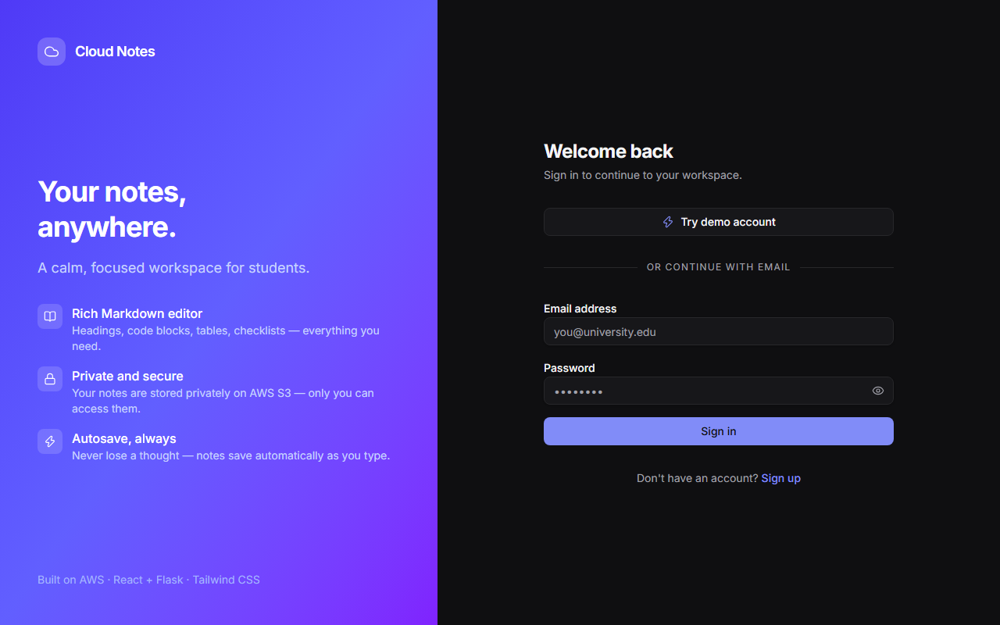
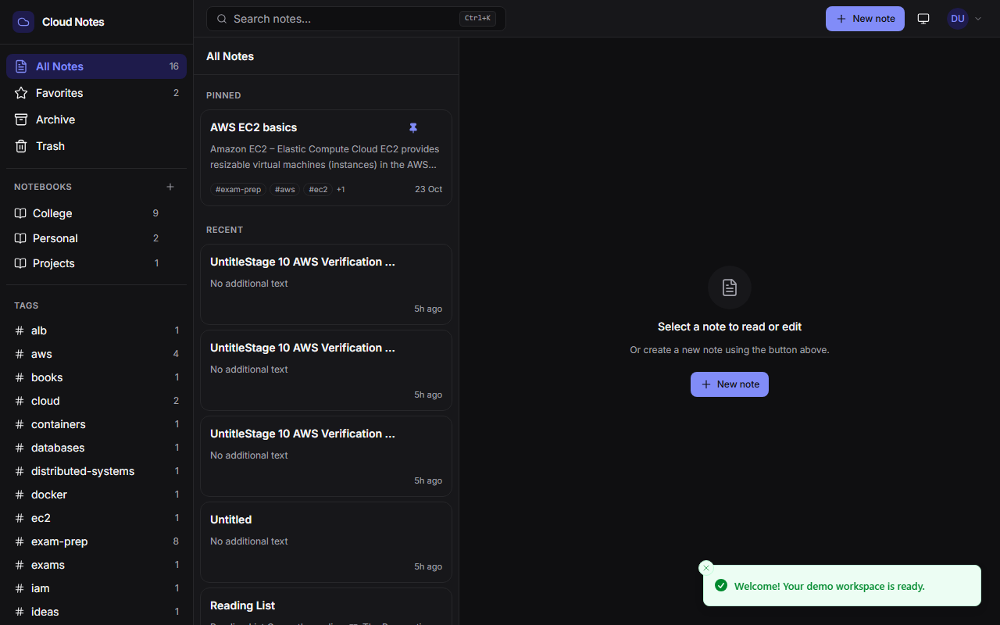
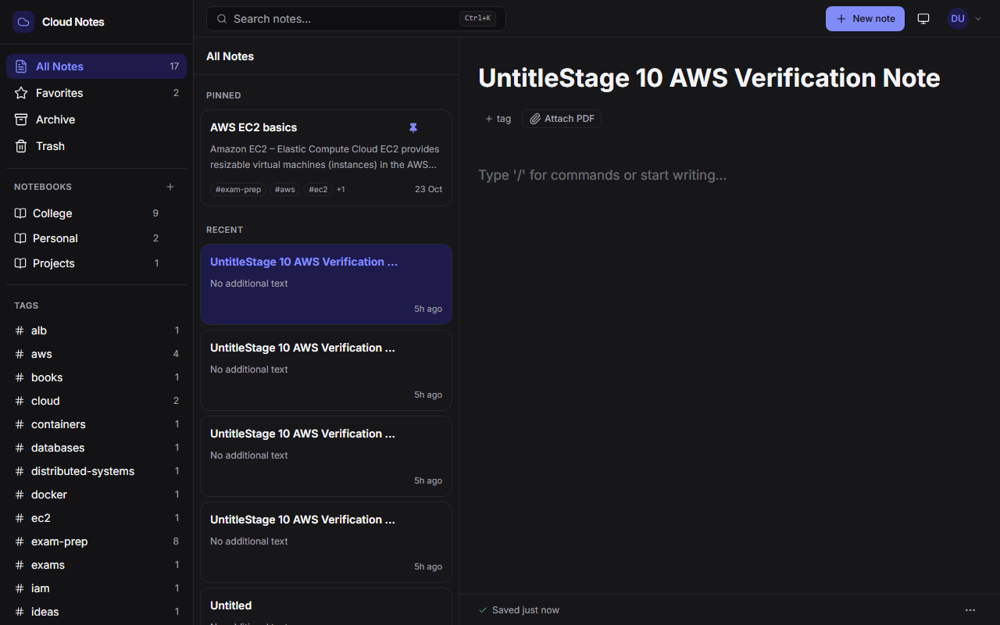
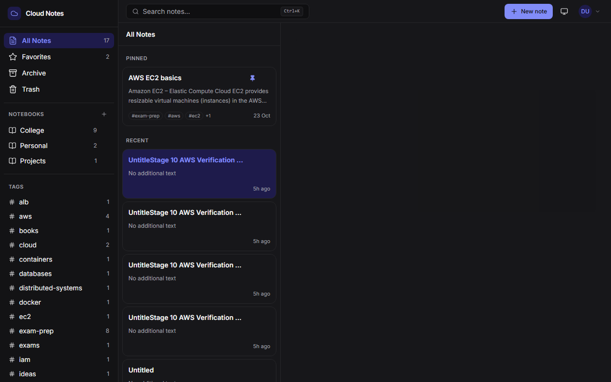
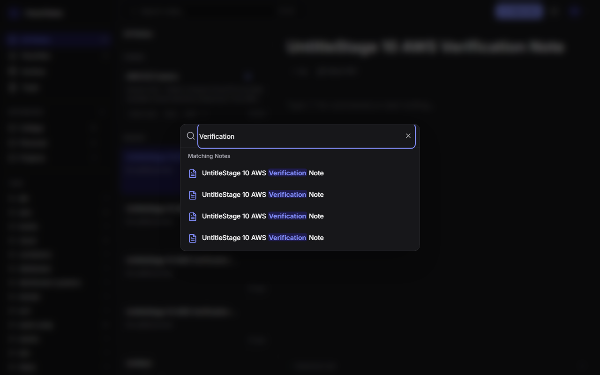
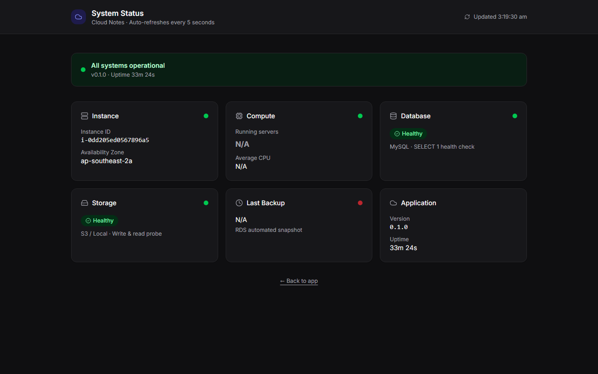

# Cloud Notes

A polished student notes web app built on AWS.  Notes are stored as Markdown
files — in S3 in the cloud, in a local folder during development.  The goal is
a tool that feels like a real product: calm, fast, and reliable.

---

## Screenshots

| Login | Workspace (light) | Workspace (dark) |
|-------|------------------|-----------------|
|  |  |  |

| Note editor with attachments | Command palette search | System Status |
|------------------------------|----------------------|---------------|
|  |  |  |

---

## Features

- **Visual Markdown Editor** — Notion-style editor powered by Milkdown Crepe:
  slash menu, floating toolbar, headings, lists, task lists, code blocks,
  tables, inline and block images.
- **Autosave** — 800 ms debounce with "Saving…" / "Saved just now" feedback and
  retry with exponential back-off on network failure.
- **Notebooks, Tags, Pin, Favorite, Archive** — Full note organisation with
  live sidebar counts and context menus.
- **Search & Command Palette** — Instant full-text search box plus `Ctrl/Cmd+K`
  command palette with live highlighted results.
- **Trash & Restore** — 30-day retention with lazy purge, 6-second undo toast,
  and manual "Empty trash".
- **Image & PDF Attachments** — Drag, drop or paste; magic-byte file type
  validation; private S3 storage; presigned URL retrieval.
- **Export** — Single note as `.md` or everything as a `.zip` with an
  `attachments/` folder.
- **Dark Mode** — Follows system preference, with a toggle in the top bar.
- **Responsive Layout** — Three panes on desktop (≥1024 px), slide-in drawer
  at tablet (640–1023 px), single pane with back arrow and floating `+` on mobile.
- **System Status Page** — Public dashboard with live instance ID, AZ, running
  server count, average CPU, database and storage health, last automated backup.
- **Demo Account** — "Try demo account" button seeds 12 realistic student notes
  instantly — no sign-up required.

---

## Technology Stack

| Layer | Technologies |
|-------|-------------|
| **Backend** | Python 3.12, Flask 3, SQLAlchemy 2, PyMySQL, PyJWT, bcrypt, boto3, python-frontmatter, gunicorn, pytest |
| **Frontend** | React 18, Vite, TypeScript (strict), Tailwind CSS, shadcn/ui, lucide-react, TanStack Query, Zustand, React Router, Sonner, @milkdown/crepe, @fontsource-variable/inter |
| **Database** | SQLite in local dev · MySQL 8 in Docker Compose and on AWS RDS |
| **Storage** | Local filesystem in dev · AWS S3 in production |
| **Container** | Multi-stage Docker (Node 20 builds frontend, Python 3.12-slim runs gunicorn) |
| **Infrastructure** | AWS CloudFormation, ALB, Auto Scaling Group, ECR, RDS, S3, IAM, CloudWatch, SNS |

---

## Architecture

```
Browser (React SPA)
  │  HTTP port 80
  ▼
Application Load Balancer   ← health check: /api/health
  │
  ▼
Auto Scaling Group: 1–2 × EC2 t3.micro (public subnets)
  each runs ONE Docker container: Flask API + compiled React, via gunicorn (port 8000)
  │               │                      │
  ▼               ▼                      ▼
RDS MySQL 8   S3 Bucket             CloudWatch Logs, Metrics,
(private)     (private, versioned,   Alarms → SNS email
              AES-256 encrypted):
              note .md files
              + attachments

Supporting: VPC, Security Groups, IAM instance role (no static keys),
            SSM Parameter Store (db password, JWT secret), ECR (Docker images),
            CloudFormation (two stacks: 01-foundation.yaml + 02-app.yaml)
```

See [docs/ARCHITECTURE.md](docs/ARCHITECTURE.md) for the full Mermaid diagram,
request flow walkthrough, and per-service reference.

---

## Local Development

### Prerequisites

- Python 3.12+
- Node.js 20+ and npm

### 1. Backend

```bash
cd backend

# Create and activate virtual environment
python -m venv .venv

# Windows
.venv\Scripts\activate
# Linux / macOS
source .venv/bin/activate

# Install dependencies
pip install -r requirements.txt

# Configure environment
cp ../.env.example ../.env
# Edit .env if needed (defaults work for local dev)

# Initialise the SQLite database
flask init-db

# Run the development server on port 8000
python wsgi.py
```

### 2. Frontend

```bash
cd frontend

# Install dependencies
npm ci

# Start Vite dev server on port 5173 (proxies /api → localhost:8000)
npm run dev
```

The frontend dev server is at `http://localhost:5173`.

Alternatively, build a production bundle and serve everything from Flask:

```bash
cd frontend && npm run build
# Flask at http://localhost:8000 serves both API and SPA
```

### 3. Run Backend Tests

```bash
cd backend
.venv\Scripts\pytest.exe tests/ -v     # Windows
# or
.venv/bin/pytest tests/ -v              # Linux / macOS
```

207 tests across auth, notes, notebooks, tags, attachments, export, status,
storage, and infrastructure template validation — all passing.

---

## Docker Compose (Local Production Stack)

Packages the Flask API and compiled React frontend into a single container,
backed by a real MySQL 8 database.

### Prerequisites

- Docker Engine / Docker Desktop (with Compose V2)

### Start

```bash
docker compose up --build
```

This starts:
1. `mysql` — MySQL 8 with healthcheck and persistent `mysql_data` volume.
2. `app` — Multi-stage build (Node 20 builds frontend, Python 3.12-slim runs
   gunicorn).  The entrypoint script retries `flask init-db` with exponential
   back-off until MySQL is ready.

Access the app at **http://localhost:8000** · Click **"Try demo account"** to log in with pre-seeded notes.

### Stop

```bash
docker compose down          # stop containers, keep volumes
docker compose down -v       # stop containers and delete volumes (clean reset)
```

---

## AWS Deployment

Cloud Notes deploys to **ap-southeast-2 (Sydney)** using two CloudFormation
stacks.  The two-stack design keeps cheap permanent resources (VPC, S3, ECR)
in a foundation stack and billable resources (RDS, EC2, ALB) in an application
stack that can be torn down without destroying the foundation.

### Prerequisites

| Tool | Version | Notes |
|------|---------|-------|
| AWS CLI v2 | ≥ 2.13 | Configured with `ap-southeast-2` as default region |
| Docker Engine | ≥ 24 | Required for `--platform linux/amd64` cross-builds |
| Git | Any | Used to tag the image with the current commit hash |

### Step 1 — Foundation Stack

Creates VPC, subnets, security groups, S3 bucket, ECR repository, and SNS topic.

```bash
aws cloudformation deploy \
    --template-file infra/01-foundation.yaml \
    --stack-name cloudnotes-foundation \
    --capabilities CAPABILITY_IAM \
    --region ap-southeast-2 \
    --parameter-overrides \
        AlertEmail=your-email@example.com
```

### Step 2 — Create Secrets

Store the database password and JWT secret in SSM Parameter Store:

```powershell
# Windows PowerShell
.\scripts\create-secrets.ps1
```

```bash
# Linux / macOS / WSL
bash scripts/create-secrets.sh
```

### Step 3 — Build and Push the Docker Image

```powershell
# Windows PowerShell
.\scripts\push-image.ps1
```

```bash
# Linux / macOS / WSL
bash scripts/push-image.sh
```

The script: authenticates to ECR via instance role, builds with
`--platform linux/amd64`, tags with git commit hash and `latest`, pushes both.

### Step 4 — Application Stack

Creates RDS, IAM role, EC2 Launch Template, ALB, Auto Scaling Group, and CloudWatch.

```bash
aws cloudformation deploy \
    --template-file infra/02-app.yaml \
    --stack-name cloudnotes-app \
    --capabilities CAPABILITY_NAMED_IAM \
    --region ap-southeast-2 \
    --parameter-overrides \
        MinSize=1 \
        DesiredCapacity=1
```

After ~10–15 minutes (mostly waiting for RDS), retrieve the ALB URL:

```bash
aws cloudformation describe-stacks \
    --stack-name cloudnotes-app \
    --region ap-southeast-2 \
    --query "Stacks[0].Outputs[?OutputKey=='LoadBalancerUrl'].OutputValue" \
    --output text
```

### Teardown

```bash
# Delete the application stack (RDS, ALB, ASG removed automatically)
aws cloudformation delete-stack \
    --stack-name cloudnotes-app \
    --region ap-southeast-2

# Empty the S3 bucket first (DeletionPolicy: Retain prevents auto-delete)
aws s3 rm s3://cloudnotes-<account-id>-ap-southeast-2 --recursive
aws s3 rb s3://cloudnotes-<account-id>-ap-southeast-2 --force

# Then delete the foundation stack
aws cloudformation delete-stack \
    --stack-name cloudnotes-foundation \
    --region ap-southeast-2
```

---

## Documentation

| Document | Description |
|----------|-------------|
| [docs/ARCHITECTURE.md](docs/ARCHITECTURE.md) | Full AWS architecture diagram, request flow, component reference |
| [docs/SECURITY.md](docs/SECURITY.md) | bcrypt, JWT, CSRF, IAM, security groups, S3 access control |
| [docs/COST.md](docs/COST.md) | AWS service costs in ap-southeast-2, monthly estimate |
| [docs/LIMITATIONS.md](docs/LIMITATIONS.md) | HTTP-only, single-AZ, single-region, known limitations |
| [docs/VIVA.md](docs/VIVA.md) | Viva preparation — architecture, scaling, storage, security Q&A |
| [docs/SPEC.md](docs/SPEC.md) | Full product specification and data model |
| [infra/README.md](infra/README.md) | CloudFormation template guide and deployment commands |
| [loadtest/README.md](loadtest/README.md) | k6 load test setup and execution instructions |

---

## Credentials and Secrets

> [!IMPORTANT]
> Cloud Notes does **not** hard-code secrets anywhere.
>
> - **Local dev**: copy `.env.example` → `.env` and edit.  `.env` is git-ignored.
> - **Docker Compose**: secrets come from the `.env` file.
> - **AWS**: database password and JWT secret are stored in **SSM Parameter Store**
>   as `SecureString` values (`/cloudnotes/db-password`, `/cloudnotes/jwt-secret`).
>   They are retrieved by the EC2 instance at boot time using the IAM instance role.
>   They are never printed in logs, stored in files, or echoed to the terminal.

---

## Project Structure

```
cloud-note-taking-app/
├── backend/
│   ├── app/
│   │   ├── routes/        # auth, notes, notebooks, tags, attachments, export, status
│   │   ├── storage/       # local.py, s3.py, factory.py (storage abstraction)
│   │   ├── config.py      # environment + Secrets Manager integration
│   │   ├── models.py      # SQLAlchemy models
│   │   ├── utils.py       # markdown strip, snippet generation
│   │   └── scripts/       # seed_demo.py
│   ├── tests/             # 207 pytest tests
│   ├── requirements.txt
│   └── wsgi.py
├── frontend/
│   └── src/
│       ├── pages/         # LoginPage, WorkspacePage, SettingsPage, StatusPage
│       ├── components/    # Editor, NoteList, Sidebar, CommandPalette, …
│       ├── stores/        # Zustand state stores
│       └── lib/           # API client, query hooks
├── infra/
│   ├── 01-foundation.yaml # VPC, S3, ECR, SNS, Security Groups
│   └── 02-app.yaml        # RDS, IAM, ALB, ASG, CloudWatch
├── scripts/
│   ├── create-secrets.ps1 / .sh   # SSM SecureString parameter creation
│   └── push-image.ps1 / .sh       # ECR image build and push
├── loadtest/
│   ├── script.js          # k6 load test (8 operations, 40 VUs, 9 min)
│   └── results/           # local-summary.json
├── docs/
│   ├── SPEC.md
│   ├── ARCHITECTURE.md
│   ├── SECURITY.md
│   ├── COST.md
│   ├── LIMITATIONS.md
│   ├── VIVA.md
│   └── screenshots/
├── Dockerfile             # multi-stage: Node 20 build + Python 3.12-slim run
├── docker-compose.yml     # mysql:8 + app container
├── docker-entrypoint.sh   # retry loop for flask init-db + gunicorn launch
├── .env.example
└── PROGRESS.md
```

---

## Credits

Built as a cloud computing student project.

**Backend libraries**: Flask, SQLAlchemy, PyMySQL, PyJWT, bcrypt, boto3,
python-frontmatter, gunicorn, pytest.

**Frontend libraries**: React, Vite, TypeScript, Tailwind CSS, shadcn/ui,
lucide-react, TanStack Query, Zustand, React Router, Sonner, Milkdown Crepe,
@fontsource-variable/inter.

All libraries used under their respective open-source licenses (MIT, Apache 2.0,
BSD, etc.).  See each package's license file for details.
