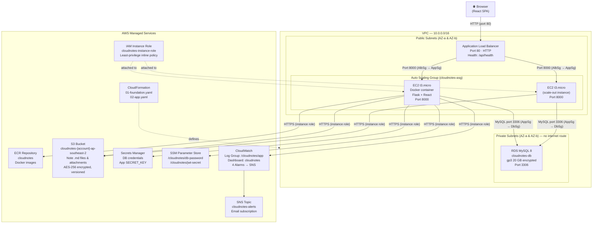

# Architecture

Cloud Notes is deployed on AWS using a two-stack CloudFormation approach.
This document explains every component, how they connect, and how traffic flows through the system.

---

## AWS Architecture Diagram



---

## Request Flow

### A typical API request

```
1. Browser sends HTTP GET /api/notes to the ALB DNS name.

2. ALB receives the request on port 80 (the only open inbound port on AlbSg).
   - Runs health checks on /api/health every 15 seconds.
   - Routes only to instances registered as "healthy" in the target group.

3. ALB forwards the request to one EC2 instance on port 8000
   (the only port AlbSg is allowed to reach via AppSg).

4. The Docker container (Flask + gunicorn, 2 workers × 4 threads) handles the request:
   a. The login_required decorator validates the httpOnly JWT cookie.
   b. The route handler queries MySQL (RDS) for the note index.
   c. Flask returns JSON.

5. Response travels back through ALB to the browser.
   Total round-trip is typically < 100 ms on a lightly loaded instance.
```

### A note save (PATCH /api/notes/:id)

```
1. Browser sends PATCH with header X-Requested-With: cloudnotes (CSRF guard).
2. Flask validates cookie → resolves current user.
3. Backend writes the .md file to S3 first (AES-256 server-side encryption).
4. If the S3 write succeeds, it updates the MySQL row in a single transaction.
5. If the DB step fails, the client receives a 500 and retries — the S3 file
   already has the content, so the next successful save is not a half-write.
   (flask reindex can rebuild the DB index from files at any time.)
```

### A file attachment request (GET /api/attachments/:id)

```
1. Browser sends GET /api/attachments/{id} with the JWT cookie.
2. Flask checks cookie → verifies the attachment belongs to the current user.
3. In S3 mode: Flask returns HTTP 302 to a 300-second presigned S3 URL.
4. Browser follows the redirect and downloads directly from S3.
   The presigned URL is scoped to the specific S3 key and expires in 5 minutes.
```

### Browser navigation (SPA fallback)

```
1. Browser requests /app/notes/abc123 (a client-side route).
2. ALB forwards to Flask.
3. Flask cannot find /app/notes/abc123 in the API route table.
4. The catch-all route detects FRONTEND_DIST_DIR is present and
   returns index.html so React Router handles the path.
5. React renders the workspace and fetches data via /api/*.
   (Any /api/* path that is not found returns a JSON 404 — not index.html.)
```

---

## Component Reference

### VPC

A dedicated Virtual Private Cloud (`10.0.0.0/16`) with DNS resolution and DNS
hostnames enabled.  All Cloud Notes resources live inside this VPC — nothing
runs in the default VPC.

The VPC contains four subnets across two Availability Zones:

| Subnet | CIDR | AZ | Internet? |
|--------|------|----|-----------|
| Public 1 | 10.0.1.0/24 | AZ-a | ✅ via IGW |
| Public 2 | 10.0.2.0/24 | AZ-b | ✅ via IGW |
| Private 1 | 10.0.11.0/24 | AZ-a | ❌ no route |
| Private 2 | 10.0.12.0/24 | AZ-b | ❌ no route |

EC2 instances run in the **public subnets** so they can reach ECR, SSM, S3,
and Secrets Manager endpoints directly over the internet — without paying for a
NAT Gateway (~\$32/month).  Network isolation is enforced at the security group
layer: no direct internet traffic reaches the instances (see Security Groups below).

RDS runs in the **private subnets** which have no internet route whatsoever.

### EC2 (Auto Scaling Group)

Each EC2 instance is a `t3.micro` running Amazon Linux 2023.  The instance
starts via a Launch Template that:

1. Installs Docker.
2. Authenticates to ECR via the instance role (no password stored).
3. Retrieves secrets from SSM Parameter Store at boot time (`--with-decryption`).
4. Runs `docker run` with the `cloudnotes:latest` image, passing environment
   variables and wiring logs to the `/cloudnotes/app` CloudWatch log group via
   the `awslogs` driver.

There is no SSH key pair.  Terminal access uses AWS Systems Manager Session
Manager (enabled by the `AmazonSSMManagedInstanceCore` managed policy).

The container runs gunicorn with **2 workers and 4 threads** each, exposing
port 8000.  Flask serves both the REST API (`/api/*`) and the compiled React
SPA (catch-all static + `index.html` fallback).

### Docker and ECR

A multi-stage `Dockerfile` builds the entire application into one image:

- **Stage 1** (`node:20-alpine`): `npm ci && npm run build` → compiles the
  React/TypeScript/Tailwind frontend into `/app/frontend/dist`.
- **Stage 2** (`python:3.12-slim`): installs Python dependencies, copies
  backend source and the compiled frontend dist, and sets `appuser` (non-root).

The image is tagged with the short Git commit hash **and** `latest`, then
pushed to the ECR repository (`cloudnotes`).  The Launch Template always pulls
`cloudnotes:latest` on each new instance launch.

### Application Load Balancer (ALB)

An internet-facing ALB deployed across both public subnets.

| Setting | Value |
|---------|-------|
| Listener | Port 80, HTTP |
| Target group port | 8000 |
| Health check path | `/api/health` |
| Health check interval | 15 s |
| Healthy threshold | 2 consecutive checks |
| Unhealthy threshold | 3 consecutive checks |

The ALB is the **only** AWS resource with an inbound rule from `0.0.0.0/0`.
All EC2 instances receive traffic exclusively from the ALB.

### Auto Scaling Group

The ASG (`cloudnotes-asg`) manages the EC2 fleet:

| Setting | Value |
|---------|-------|
| Min instances | 1 |
| Max instances | 2 |
| Desired capacity | 1 |
| Health check type | ELB (ALB health checks) |
| Health check grace period | 600 s (accommodates cold boot: Docker pull + DB init ~370 s) |
| Metrics granularity | 1-minute group metrics |
| Update policy | Rolling (`MinInstancesInService: 1, MaxBatchSize: 1, PauseTime: PT5M`) |

**Target tracking scaling policy** (`AppScalingPolicy`):

The ASG uses a CPU target-tracking policy with a **50% average CPU target**.
When the ASG's average CPU rises above 50%, EC2 Auto Scaling automatically
adds an instance (up to `MaxSize = 2`).  When average CPU drops back down and
stays low for the scale-in cooldown period, Auto Scaling removes the extra instance.

- Metric: `ASGAverageCPUUtilization`
- Target: 50%
- Estimated instance warmup: 120 s (new instances are excluded from the
  average during warmup to prevent premature scale-in)

The launch template pulls `cloudnotes:latest` on boot, so there is no manual
step needed after pushing a new image — an instance refresh picks it up.

### RDS MySQL 8

| Setting | Value |
|---------|-------|
| Engine | MySQL 8.0 |
| Instance class | db.t3.micro |
| Storage | 20 GB gp3, encrypted (AES-256) |
| Multi-AZ | No (single AZ) |
| Publicly accessible | No |
| Backup retention | 1 day |
| Subnets | Private subnets only |
| Security group | Accepts port 3306 from `AppSg` only |

RDS stores users, notebook metadata, the notes index (title, snippet,
search_text, tags, flags), and attachments metadata.  The actual note **body**
is stored in S3 as a Markdown file — RDS is the index, S3 is the source of truth.

The database password is managed by SSM Parameter Store (`/cloudnotes/db-password`)
and injected via CloudFormation dynamic reference at deploy time.

### S3

| Setting | Value |
|---------|-------|
| Bucket name | `cloudnotes-{AccountId}-ap-southeast-2` |
| Public access | Fully blocked |
| Versioning | Enabled |
| Default encryption | AES-256 (SSE-S3) |
| Lifecycle: noncurrent versions | Expire after 30 days |
| Lifecycle: incomplete multiparts | Abort after 7 days |
| Deletion policy | Retain (must be emptied manually before stack deletion) |

Note files are stored at `users/{user_id}/notes/{note_id}.md` in YAML
front-matter + Markdown body format.  Attachments are stored at
`users/{user_id}/attachments/{id}.{ext}`.

The backend uses a **Storage abstraction** (`backend/app/storage/`):
`LocalStorage` writes to a local folder in development; `S3Storage` uses boto3
with the instance role (no access keys in code).  The backend is selected by
the `STORAGE_BACKEND` environment variable (`local` or `s3`).

### IAM Instance Role

The EC2 instances assume the `cloudnotes-instance-role` IAM role via an
instance profile.  The role has one inline least-privilege policy with six
statements:

| Capability | Actions | Scope |
|------------|---------|-------|
| S3 (bucket) | `ListBucket`, `GetBucketLocation` | Specific bucket ARN |
| S3 (objects) | `GetObject`, `PutObject`, `DeleteObject` | Bucket objects (`/*`) |
| ECR (auth) | `GetAuthorizationToken` | `*` (required by AWS) |
| ECR (pull) | `BatchCheckLayerAvailability`, `GetDownloadUrlForLayer`, `BatchGetImage` | Specific ECR repo ARN |
| CloudWatch Logs | `CreateLogStream`, `PutLogEvents`, `DescribeLogStreams` | Specific log group ARN |
| SSM (secrets) | `GetParameter` | `/cloudnotes/db-password`, `/cloudnotes/jwt-secret` only |
| Status APIs (read-only) | `DescribeAutoScalingGroups`, `GetMetricStatistics`, `DescribeDBInstances` | `*` (read-only monitoring) |

The `AmazonSSMManagedInstanceCore` AWS managed policy is also attached for
Session Manager terminal access.

No static access keys are used anywhere.

### CloudWatch

Three types of CloudWatch resources are provisioned:

**Log Group** (`/cloudnotes/app`, 7-day retention):
Receives structured JSON log lines from each container via the `awslogs` driver.
Each log record contains: `time`, `level`, `message`, `request_id`, `route`,
`status`, `duration_ms`.

**Dashboard** (`cloudnotes`):
8 metric widgets — ASG CPU, in-service instance count, ALB request count, ALB
p99 response time, ALB 5XX errors, ALB healthy hosts, RDS CPU, RDS connections.

**4 CloudWatch Alarms** (all notify the `cloudnotes-alerts` SNS topic):

| Alarm | Condition |
|-------|-----------|
| `cloudnotes-asg-high-cpu` | ASG CPU > 70% for 2 consecutive minutes |
| `cloudnotes-alb-5xx` | ALB 5XX count ≥ 10 in a 5-minute window |
| `cloudnotes-alb-unhealthy-hosts` | Unhealthy ALB hosts ≥ 1 for 2 minutes |
| `cloudnotes-rds-high-cpu` | RDS CPU > 80% for 5 consecutive minutes |

### CloudFormation

The infrastructure is defined in two stacked CloudFormation templates:

| Template | Stack name | Contents |
|----------|-----------|----------|
| `infra/01-foundation.yaml` | `cloudnotes-foundation` | VPC, subnets, security groups, S3, ECR, SNS |
| `infra/02-app.yaml` | `cloudnotes-app` | RDS, IAM, ALB, ASG, CloudWatch, Launch Template |

The application stack imports all shared resource IDs from the foundation stack
via `Fn::ImportValue`.  This split allows the billable resources (RDS, EC2, ALB)
to be torn down independently without destroying the permanent foundation resources.

Deploying or updating the entire infrastructure is a single `aws cloudformation deploy` command per template.  Rollback is automatic on failure.
