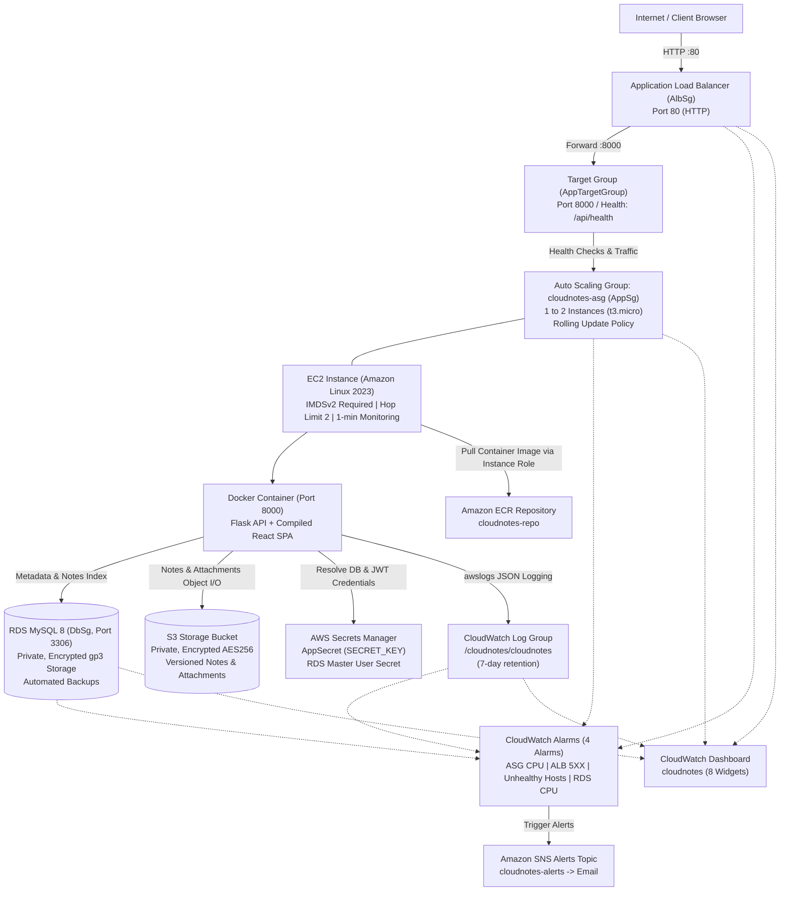

# Cloud Notes Infrastructure (AWS CloudFormation)

This directory contains the AWS CloudFormation template and documentation for deploying the **Cloud Notes** web application on Amazon Web Services in region `ap-south-1` (Mumbai).

> **Important**: In Stage 8A & 8B, this template is created, configured, and validated only. **Nothing has been deployed yet.** `DesiredCapacity` and `MinCapacity` default to `0` to ensure zero instances run during template validation.

---

## Architecture Overview



---

## Stack Parameters (`infra/stack.yaml`)

| Parameter | Type | Default | Description |
| :--- | :--- | :--- | :--- |
| `ProjectName` | String | `cloudnotes` | Prefix used for resource naming and resource tags. |
| `VpcId` | `AWS::EC2::VPC::Id` | *(None)* | The target VPC (typically the default VPC). |
| `SubnetIds` | `List<AWS::EC2::Subnet::Id>` | *(None)* | At least two public subnet IDs in different Availability Zones. |
| `AlertEmail` | String | *(None)* | Operator email address for CloudWatch alarm notifications. |
| `ImageTag` | String | `latest` | Tag of the container image to pull from ECR. |
| `InstanceType` | String | `t3.micro` | EC2 instance size for application servers. |
| `DBInstanceClass` | String | `db.t3.micro` | RDS MySQL instance class. |
| `BackupRetentionDays` | Number | `7` | Retention period in days for automated RDS daily snapshots (1 to 35). |
| `MinCapacity` | Number | `0` | Minimum capacity for ASG (`0` allows scaling to zero during setup). |
| `DesiredCapacity` | Number | `0` | Initial target count of instances (`0` ensures zero running instances until deploy). |
| `MaxCapacity` | Number | `2` | Maximum instance limit for Auto Scaling Group. |
| `CpuTarget` | Number | `50` | Target average CPU percentage for ASG target-tracking auto-scaling. |

---

## Resources Explained in Plain Language

### 1. Amazon ECR Repository (`EcrRepository`)
- **What it is**: A private Docker container image registry hosted on AWS.
- **Why it exists**: Stores the unified Docker image containing the Flask backend and compiled React single-page frontend.
- **Key Settings**:
  - `ImageScanningConfiguration.ScanOnPush: true`: Scans pushed container images automatically for software vulnerabilities.
  - `LifecyclePolicy`: Retains only the last 5 images, pruning older images to prevent accumulating storage costs.
  - `EmptyOnDelete: true`: Allows the repository to be cleanly deleted by CloudFormation even if images exist.
  - `DeletionPolicy: Delete`: Removes the repository automatically when the stack is deleted.

### 2. Amazon S3 Storage Bucket & Bucket Policy (`NotesBucket`, `NotesBucketPolicy`)
- **What it is**: Highly durable, secure object storage.
- **Why it exists**: Serves as the primary source of truth for user notes (stored as Markdown `.md` files) and uploaded user attachments (images, PDFs).
- **Key Settings**:
  - `PublicAccessBlockConfiguration`: All 4 public access block settings (`BlockPublicAcls`, `BlockPublicPolicy`, `IgnorePublicAcls`, `RestrictPublicBuckets`) are enabled. The bucket and all objects are completely private.
  - `VersioningConfiguration.Status: Enabled`: Keeps previous revisions of notes and attachments, protecting against accidental deletion or corruption.
  - `BucketEncryption`: Enforces AES-256 server-side encryption (`SSE-S3`) on all stored objects at rest.
  - `LifecycleConfiguration`: Automatically expires non-current versions after 30 days and aborts incomplete multipart uploads after 7 days.
  - `NotesBucketPolicy`: Enforces transport security by explicitly denying any access requests made over unencrypted HTTP (`aws:SecureTransport: false`).
  - `DeletionPolicy: Retain`: Prevents stack deletion failure if the bucket contains objects.

### 3. AWS Secrets Manager (`AppSecret` & RDS Master User Secret)
- **What it is**: Secure, encrypted secret storage service.
- **Why it exists**: Keeps application and database secrets out of source code, environment files, and version control.
- **Secrets Defined**:
  1. `AppSecret`: Stores a 64-character randomly generated alphanumeric string used by Flask as `SECRET_KEY` for cryptographically signing JWT authentication session cookies.
  2. `DBInstance.MasterUserSecret`: Managed automatically by RDS via `ManageMasterUserPassword: true`. RDS generates, encrypts, and rotates the database master password in Secrets Manager without exposing credentials in the CloudFormation template or outputs.

### 4. Security Groups (`AlbSg`, `AppSg`, `DbSg`)
A strict, three-tier inbound security chain:
1. **`AlbSg` (Load Balancer)**:
   - Inbound: Accepts TCP port 80 (HTTP) from `0.0.0.0/0` (the internet).
   - Outbound: Allows traffic to downstream targets.
2. **`AppSg` (EC2 Instances)**:
   - Inbound: Accepts TCP port 8000 **only from `AlbSg`**. Direct internet access to the application instances is strictly blocked.
   - Outbound: Allows traffic to AWS APIs (Secrets Manager, S3, ECR, CloudWatch) and to the RDS database on port 3306.
3. **`DbSg` (RDS MySQL Database)**:
   - Inbound: Accepts TCP port 3306 **only from `AppSg`**. Direct access from the internet or the load balancer is impossible.

### 5. Amazon RDS MySQL 8 Database (`DBSubnetGroup`, `DBInstance`)
- **What it is**: A managed relational database instance running MySQL 8.
- **Why it exists**: Maintains the metadata index for users, notebooks, tags, notes metadata, search text, and trash flags.
- **Key Settings**:
  - `DBInstanceClass`: Configurable via parameter (default `db.t3.micro`).
  - `AllocatedStorage`: 20 GB `gp3` storage with encryption at rest (`StorageEncrypted: true`).
  - `PubliclyAccessible: false`: The database has no public IP address and lives entirely inside the VPC private network.
  - `MultiAZ: false`: Single Availability Zone deployment to minimize costs.
  - `BackupRetentionPeriod`: Configurable via `BackupRetentionDays` (default 7 days).
  - `DeletionProtection: false` and `DeleteAutomatedBackups: true`: Clean teardown support.
  - `DeletionPolicy: Delete`: Skips the final snapshot upon stack deletion.

### 6. CloudWatch Log Group (`AppLogGroup`)
- **What it is**: Centralized AWS log management.
- **Why it exists**: Collects structured JSON application logs emitted by the Gunicorn application container.
- **Key Settings**:
  - `LogGroupName: /cloudnotes/{ProjectName}`
  - `RetentionInDays: 7`: Retains logs for 7 days to keep storage costs minimal while providing ample diagnostic history.

### 7. IAM Role and Instance Profile (`AppInstanceRole`, `AppInstanceProfile`)
- **What it is**: Identity and Access Management credentials attached directly to EC2 instances via an Instance Profile.
- **Why it exists**: Allows EC2 instances to interact securely with AWS services without hard-coding AWS access keys or secret keys in files or environment variables.
- **Managed Policy**:
  - `arn:aws:iam::aws:policy/AmazonSSMManagedInstanceCore`: Enables AWS Systems Manager Session Manager for secure, keyless terminal access without opening SSH port 22.
- **Least-Privilege Policy Actions**:
  - **S3**: `s3:ListBucket` and `s3:GetBucketLocation` on the bucket ARN; `s3:GetObject`, `s3:PutObject`, and `s3:DeleteObject` scoped specifically to `arn:aws:s3:::{bucket}/*`.
  - **Secrets Manager**: `secretsmanager:GetSecretValue` scoped strictly to `AppSecret` ARN and `DBInstance.MasterUserSecret.SecretArn`.
  - **SSM Parameter Store**: `ssm:GetParameter`, `ssm:GetParameters`, `ssm:GetParametersByPath` scoped strictly to `arn:aws:ssm:...:parameter/cloudnotes/*`.
  - **ECR**: `ecr:BatchCheckLayerAvailability`, `ecr:GetDownloadUrlForLayer`, and `ecr:BatchGetImage` scoped strictly to the ECR repository ARN; `ecr:GetAuthorizationToken` on `*` (required by AWS API as it does not support resource-level permissions).
  - **CloudWatch Logs**: `logs:CreateLogStream`, `logs:PutLogEvents`, and `logs:DescribeLogStreams` scoped strictly to the project log group ARN.
  - **Status Page Read-Only**: `autoscaling:DescribeAutoScalingGroups`, `cloudwatch:GetMetricStatistics`, and `rds:DescribeDBInstances` on `*` (used by `/api/status` to query server count, CPU, and backup timestamps without modifying any resources).

### 8. Amazon SNS Topic and Alert Subscription (`AlertsTopic`, `AlertsEmailSubscription`)
- **What it is**: Pub/sub messaging service.
- **Why it exists**: Delivers critical operational alerts and CloudWatch alarm breach notifications to the operator's email address (`AlertEmail`).

### 9. EC2 Launch Template (`AppLaunchTemplate`)
- **What it is**: A blueprint specification defining how EC2 instances are configured at launch.
- **Key Settings**:
  - `ImageId`: Uses dynamic SSM reference `{{resolve:ssm:/aws/service/ami-amazon-linux-latest/al2023-ami-kernel-default-x86_64}}` to automatically select the latest Amazon Linux 2023 x86_64 AMI.
  - `MetadataOptions`: `HttpTokens: required` enforces IMDSv2; `HttpPutResponseHopLimit: 2` permits containerized processes inside Docker to fetch instance metadata.
  - `Monitoring.Enabled: true`: Enables 1-minute detailed CloudWatch metrics so scaling behavior is immediately visible.
  - `CreditSpecification.CpuCredits: standard`: Uses standard burst credits on `t3.micro` to eliminate unexpected charges.
  - `IamInstanceProfile`: Attached to `AppInstanceProfile`.
  - `SecurityGroupIds`: Attached to `AppSg`.
  - **No Key Pair**: No SSH key pair is attached; administrative access is provided via AWS Systems Manager Session Manager.
  - **User Data (`UserData`)**:
    - Installs and starts the Docker daemon.
    - Authenticates Docker against Amazon ECR using the EC2 instance role (`aws ecr get-login-password`).
    - Starts the unified container (`docker run -d --restart always -p 8000:8000`) using the `awslogs` log driver streaming directly to `/cloudnotes/{ProjectName}`.
    - Passes environment variables (`DB_SECRET_ARN`, `APP_SECRET_ARN`, `DB_HOST`, `DB_NAME`, `STORAGE_BACKEND=s3`, `S3_BUCKET`, `AWS_REGION`, `ASG_NAME=cloudnotes-asg`, `DB_INSTANCE_ID`, `COOKIE_SECURE=false`).
    - Secrets are never echoed, logged, or written to disk.

### 10. Application Load Balancer, Target Group & Listener (`AppAlb`, `AppTargetGroup`, `AppAlbListener`)
- **What it is**: High-availability Layer 7 load balancer and traffic router.
- **Key Settings**:
  - `AppAlb`: Internet-facing, deployed across the specified public subnets in multiple AZs, protected by `AlbSg`.
  - `AppTargetGroup`: Routes HTTP traffic to port 8000 on registered instances. Health check config:
    - Path: `/api/health`
    - Interval: 15 seconds
    - Healthy threshold: 2 consecutive successes (30 seconds to join service)
    - Unhealthy threshold: 3 consecutive failures (45 seconds to remove from service)
  - `AppAlbListener`: Listens on HTTP port 80 and forwards all incoming requests to `AppTargetGroup`.

### 11. Auto Scaling Group & Scaling Policy (`AppAsg`, `AppScalingPolicy`)
- **What it is**: Elastic compute management automating instance provisioning, health monitoring, and scaling.
- **Key Settings**:
  - Name: `cloudnotes-asg`
  - Health check: `HealthCheckType: ELB` with a `300` second grace period to allow container startup before evaluating instance health.
  - Metrics collection: Enabled with 1-minute granularity.
  - Rolling update policy: `AutoScalingRollingUpdate` with `MaxBatchSize: 1` and `PauseTime: PT5M`.
  - Target tracking scaling policy (`AppScalingPolicy`): Maintains average CPU utilization across the group at `CpuTarget` (default 50%), with a 120-second instance warmup period.

### 12. CloudWatch Alarms (`AlarmAsgHighCpu`, `AlarmAlbTarget5xx`, `AlarmAlbUnhealthyHosts`, `AlarmRdsHighCpu`)
Four proactive operational alarms configured to dispatch notifications to `AlertsTopic`:
1. `AlarmAsgHighCpu`: ASG average CPU > 70% for 2 consecutive 1-minute evaluation periods.
2. `AlarmAlbTarget5xx`: ALB target 5XX error count >= 10 in a 5-minute period.
3. `AlarmAlbUnhealthyHosts`: Unhealthy target host count >= 1 for 2 consecutive 1-minute periods.
4. `AlarmRdsHighCpu`: RDS MySQL CPU utilization > 80% for a 5-minute period.

### 13. CloudWatch Dashboard (`AppDashboard`)
- **What it is**: Operational visualization console named `cloudnotes`.
- **Widgets Provided** (8 widgets):
  1. **ASG CPU Utilization**: Average CPU across all running instances in the Auto Scaling Group.
  2. **ASG In-Service Instances**: Number of healthy, active instances currently handling requests.
  3. **ALB Request Count**: Total incoming HTTP requests to the Application Load Balancer.
  4. **Target Response Time**: Average latency for requests handled by application containers.
  5. **ALB Target 5XX Count**: Count of server-side application errors.
  6. **ALB Healthy Host Count**: Count of instances currently passing load balancer health checks.
  7. **RDS CPU Utilization**: Database CPU usage percentage.
  8. **RDS Database Connections**: Number of active client connections to MySQL.

---

## Request Flow Walkthrough

```
1. Client Request
   Client opens http://<LoadBalancerUrl>/
   ├── DNS resolves to the ALB's public IP addresses across multiple Availability Zones.
   └── Browser initiates an HTTP GET request to port 80.

2. Application Load Balancer Routing
   ALB evaluates incoming traffic on listener port 80:
   ├── Verifies against AlbSg security group (permits 0.0.0.0/0 on port 80).
   ├── Evaluates registered targets in AppTargetGroup.
   └── Forwards request to port 8000 on an InService instance in AppAsg.

3. Security Boundary & Container Execution
   Traffic reaches the EC2 instance:
   ├── AppSg verifies inbound traffic originates strictly from AlbSg on port 8000.
   ├── Docker daemon routes traffic to the container's Gunicorn WSGI server.
   └── Container serves static frontend assets (HTML/JS/CSS) or processes Flask API routes (/api/*).

4. Production Secrets Resolution & Storage Access
   When processing stateful requests:
   ├── Flask queries AWS Secrets Manager using the attached AppInstanceProfile to retrieve
   │   database credentials and the application SECRET_KEY (cached in memory).
   ├── Database operations query the private RDS MySQL instance over port 3306 (permitted by DbSg).
   └── Note content and file attachments are read from / written to S3 via TLS (boto3 client).

5. Logging & Metrics
   ├── The container's awslogs log driver streams structured JSON logs to /cloudnotes/cloudnotes.
   └── CloudWatch continuously aggregates detailed 1-minute metrics for alarms and the dashboard.
```

---

## Instance Failure & Recovery Walkthrough

When an EC2 instance or application container crashes:

```
1. Failure Detection (0 - 45 seconds)
   ├── The application container stops responding to GET /api/health.
   ├── The ALB target group health check fails 3 consecutive times (15-second interval).
   └── ALB immediately marks the target Unhealthy and ceases sending user traffic to it.

2. Alarm Triggering (45 - 120 seconds)
   ├── The UnHealthyHostCount metric rises to 1.
   ├── CloudWatch Alarm AlarmAlbUnhealthyHosts breaches its threshold for 2 consecutive minutes.
   └── CloudWatch sends an alert notification to AlertsTopic, delivering an email to AlertEmail.

3. Auto Scaling Group Remediation (1 - 3 minutes)
   ├── Because HealthCheckType: ELB is configured, the Auto Scaling Group receives the
   │   unhealthy status signal from the target group.
   ├── ASG initiates termination of the degraded EC2 instance.
   └── ASG automatically requests a replacement instance from EC2 based on AppLaunchTemplate.

4. Replacement Launch & Initialization (3 - 5 minutes)
   ├── EC2 launches a new t3.micro instance running Amazon Linux 2023.
   ├── UserData script executes:
   │   ├── Installs and starts Docker.
   │   ├── Authenticates against ECR using the instance role.
   │   └── Launches the application container with restart: always and awslogs logging.
   └── The container starts Gunicorn and executes database connection checks.

5. Recovery & Traffic Resumption (5 - 6 minutes)
   ├── ALB resumes polling GET /api/health on port 8000.
   ├── After 2 consecutive successful checks (HealthyThresholdCount: 2), the instance is marked Healthy.
   ├── ALB resumes routing user traffic to the replacement instance.
   └── AlarmAlbUnhealthyHosts clears and returns to OK status.
```

---

## Stack Outputs

| Output Key | Description | Export Name |
| :--- | :--- | :--- |
| `ProjectName` | Project identifier | — |
| `VpcId` | Target VPC ID | — |
| `SubnetIds` | Comma-separated list of Subnet IDs | — |
| `EcrRepositoryUri` | Docker registry URI for image pushes | `${ProjectName}-EcrRepositoryUri` |
| `EcrRepositoryArn` | ARN of the ECR repository | — |
| `S3BucketName` | Name of the S3 storage bucket | `${ProjectName}-S3BucketName` |
| `S3BucketArn` | ARN of the S3 storage bucket | — |
| `AppSecretArn` | Secrets Manager ARN for application secret | `${ProjectName}-AppSecretArn` |
| `DbSecretArn` | Secrets Manager ARN for RDS master password | `${ProjectName}-DbSecretArn` |
| `DbEndpointAddress` | Host address of RDS MySQL database | `${ProjectName}-DbEndpointAddress` |
| `DbEndpointPort` | Port of RDS MySQL database (3306) | `${ProjectName}-DbEndpointPort` |
| `DbEndpoint` | Host address of RDS MySQL database | `${ProjectName}-DbEndpoint` |
| `DbName` | Name of hosted MySQL database (`cloudnotes`) | — |
| `AlbSecurityGroupId` | Security group ID for ALB | `${ProjectName}-AlbSecurityGroupId` |
| `AppSecurityGroupId` | Security group ID for application EC2 | `${ProjectName}-AppSecurityGroupId` |
| `DbSecurityGroupId` | Security group ID for RDS MySQL | `${ProjectName}-DbSecurityGroupId` |
| `LogGroupName` | CloudWatch Log Group name (`/cloudnotes/cloudnotes`)| `${ProjectName}-LogGroupName` |
| `LogGroupArn` | CloudWatch Log Group ARN | — |
| `InstanceRoleArn` | IAM Role ARN for application EC2 instances | — |
| `InstanceProfileArn`| IAM Instance Profile ARN for EC2 | `${ProjectName}-InstanceProfileArn` |
| `InstanceProfileName`| IAM Instance Profile Name for EC2 | — |
| `AlertsTopicArn` | SNS Topic ARN for operational alerts | `${ProjectName}-AlertsTopicArn` |
| `LoadBalancerDnsName`| Public DNS name of the ALB | `${ProjectName}-AlbDnsName` |
| `LoadBalancerUrl` | Full HTTP URL to access Cloud Notes | `${ProjectName}-LoadBalancerUrl` |
| `DashboardUrl` | Direct URL to CloudWatch operational dashboard | — |

---

## Validation & Automated Testing

### Tool Availability Report
- **AWS CLI (`aws`)**: Not installed on the local Windows development host.
- **cfn-lint (`cfn-lint`)**: Not installed on the local Windows development host.
- **Automated Validation**: Because external CLI binaries are not available in this host environment, template structure, parameters, syntax, resource dependencies, security boundaries, and outputs are thoroughly verified using automated Python test suites.

### Running Automated CloudFormation Tests

```bash
# Activate virtual environment
cd backend
.venv\Scripts\activate

# Run both Stage 8A and Stage 8B infrastructure validation tests
pytest tests/test_stage8a.py tests/test_stage8b.py -v

# Run entire application test suite (180 tests)
pytest tests/ -v
```

### Remote AWS Validation Commands (When AWS CLI is Installed)

When the AWS CLI and credentials are configured on an administrative machine:

```bash
# 1. Validate template syntax against AWS CloudFormation API
aws cloudformation validate-template \
  --template-body file://infra/stack.yaml \
  --region ap-south-1

# 2. Run cfn-lint against the template
cfn-lint infra/stack.yaml
```

---

## Teardown & Manual Cleanup

When the CloudFormation stack is deleted:
1. **ECR Repository**: Automatically deleted because `EmptyOnDelete: true` is configured.
2. **RDS Database**: Automatically deleted without creating a final snapshot because `DeletionPolicy: Delete` is configured.
3. **Secrets Manager & Log Group**: Automatically deleted because `DeletionPolicy: Delete` is configured.
4. **Auto Scaling Group & Load Balancer**: Automatically deleted along with alarms and dashboard.
5. **S3 Bucket (`NotesBucket`)**:
   - Because `DeletionPolicy: Retain` is set, CloudFormation does **not** delete the bucket automatically if it contains objects.
   - To clean up the S3 bucket completely:
     ```bash
     # List objects and versions
     aws s3 ls s3://<S3BucketName> --recursive

     # Empty all objects and object versions
     aws s3 rm s3://<S3BucketName> --recursive

     # Delete the bucket after emptying:
     aws s3 rb s3://<S3BucketName> --force
     ```
